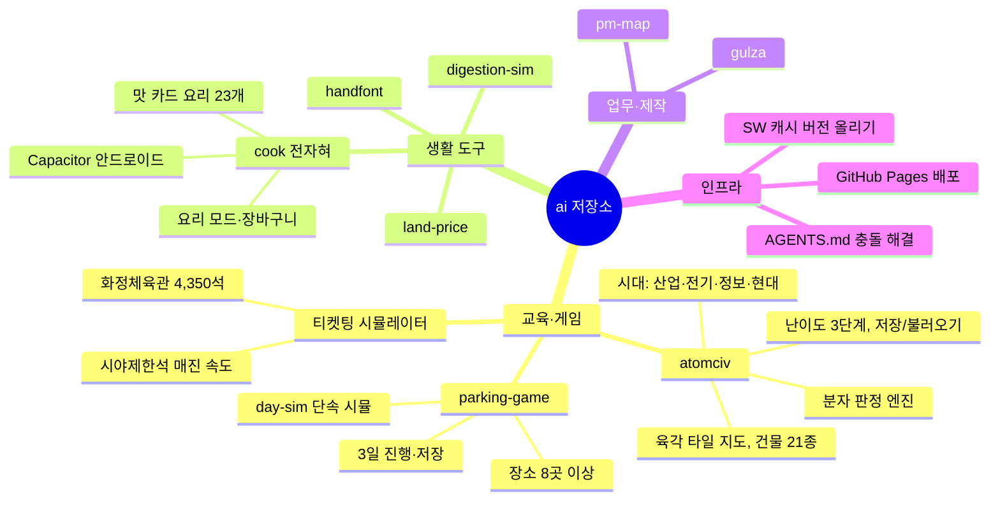

# AI 워크스페이스 작업 정리 (2026-10-29 ~ 2026-11-26)

> 출처: 저장소 `mungbws1031/ai`의 git 로그(커밋 제목 기준 요약). 코드 동작을 직접 검증한 내용은 아니다.

## 1. 한눈에 보기

| 프로젝트 | 한 줄 설명 | 기간 | 커밋 | 폴더 |
|---|---|---|---|---|
| atomciv | 원자→분자→발명→시대, 초등학생용 과학 게임 | 11/18~11/23 | 36 | `atomciv/` |
| cook (전자혀) | 요리 초보용 맛 튜닝 계산기 + 안드로이드 셸 | 11/18~11/24 | 32 | `cook/` |
| parking-game | 가로 화면 주차 게임 '주차 한 판' | 11/15~11/24 | 15 | `parking-game/` |
| 티켓팅 시뮬레이터 | 공연장 좌석 예매 연습, 고려대 화정체육관 추가 | 11/24~11/26 | 약 14 | `site/index.html` |
| pm-map | PM 역량 맵 PWA, 캐릭터·팀 퀘스트 | 11/17~11/24 | 3 | `pm-map/` |
| land-price | 영동군 심천면 초강리 농지 실거래 인포그래픽 | 11/04 | 6 | `land-price/` |
| digestion-sim | 식사별 72시간 소화·배변 시뮬레이터 | 10/29~11/04 | 15 | `digestion-sim/` |
| handfont | 손글씨 → TTF 폰트 생성 | 10/31~11/07 | 5 | `handfont/` |
| gulza | 무료 모션 자막 제작기 (외부 MIT 사본 추가) | 11/15 | 1 | `gulza/` |

공통점: 대부분 단일 HTML 또는 바닐라 JS PWA이고 GitHub Pages로 배포한다.

## 2. 마인드맵 (Mermaid)

## 3. 프로젝트별 타임라인

### atomciv
- 11/18: 분자 판정 엔진, 실험실 화면·도감, 미션·기술 지도, PWA와 문서
- 11/19: 산업·전기·정보 시대, 육각 타일 영토 지도, 진행 파일 저장/불러오기, Pages 배포
- 11/20: 현대 시대, 새 원자와 분자 다수, 일상 분자 14개
- 11/21: 난이도 선택, 건물 21종과 배치 규칙, 발명 40종 추가, 리뷰 반영
- 11/23: 벤치의 원자를 눌러 제거

### cook (전자혀)
- 11/18~19: 맛별 대표 요리와 재료 계산, 장바구니, 하단 탭 4개 정리, Capacitor 안드로이드 셸, AAB 빌드 CI, 개인정보처리방침, 출시 체크리스트, 스토어 이미지
- 11/21: 맛 카드 요리 23개에 조리 순서, 만드는 법 화면
- 11/23: 요리 모드(단계·타이머·맛보기 처방), 양념을 숟가락 양으로, 레시피 감수 3차, 시험용 APK
- 11/24: 첫 화면에서 요리 이름·재료로 검색, 인분 변경 후 담기

### parking-game '주차 한 판'
- 11/15~21: 시험판(하루 버티기 + 직접 주차), 조이스틱 조작, 장소 레벨 다수 추가
- 11/23: 매 판 무작위, 눈에 보이는 단속원·주민 시야
- 11/24: 자석 주차, 렌더러 분리, 단속 시뮬 모듈(`day-sim.js`), 3일 일정, 정식 화면, 난이도 어려움/헬만

### 티켓팅 시뮬레이터 (`site/index.html`)
- 11/24: 화정체육관 추가, 실제 좌석배치도 반영, 난이도에서 쉬움·보통 제거
- 11/25: 구역 배치 모양 수정, 총 4,350석
- 11/26: 전석 11만/시야제한 9.9만, 좌석 선택 모달화, 새로고침 모드 제거, 시야제한석이 훨씬 늦게 매진

### 그 외
- pm-map: 16개 역량 맵, PM 캐릭터, 팀 명단, 퀘스트 배정, 퀴즈 직후 캐릭터 갱신
- land-price: 초강리 농지, 대지·임야 추가, 14개 마을 비교, 큰 글씨 폰 버전
- digestion-sim: 72시간 모델, 사진으로 영양 추정, 하루 3끼+간식, 검증된 출처 목록
- handfont: 손글씨 템플릿 스캔 → 폰트, 24개 자모로 한글 자동 조합, 위치별 자모 모양

## 4. 다음 단계 후보 (추정, 확인 필요)
- [ ] cook: 플레이 스토어 출시 체크리스트(`cook/docs/RELEASE.md`) 마무리
- [ ] parking-game: 4일차 이후, 판정 근거 화면 확장
- [ ] atomciv: 난이도별 밸런스 점검
- [ ] 이 정리를 Notion DB(프로젝트/업무)로 이관

## 5. 활용 방법
- Obsidian: 이 파일을 vault에 넣으면 Mermaid 마인드맵이 그대로 보인다.
- Notion: 같은 내용이 페이지로 올라가 있다.
